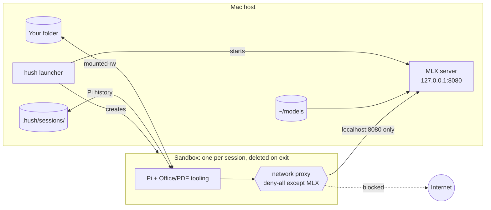

# hush

Private, offline AI work on your own files.  A little wrapper for Docker sbx, 
Pi coding agent and Apple MLX local inference.

`cd` into a folder, run `hush`, and you're talking to **Pi**, a coding agent,
running in a throwaway Docker Sandbox (`sbx`). It can see only that folder, it
can't reach the internet, and its model runs locally on your Mac with MLX.
Nothing leaves the machine.

Pi comes with Word, Excel, PowerPoint and PDF tooling, so it's as happy
reading a contract as writing a script.

## You'll need

- An **Apple Silicon Mac** with room for a model in memory (the default needs
  about 35 GB; smaller models work too).
- **Docker Sandboxes**:
  `brew trust docker/tap && brew install docker/tap/sbx && sbx login`
- **MLX**: `pip install mlx-lm`
- At least one MLX model in `~/models/<publisher>/<repo>/`.

Then, once:

```bash
ln -s "$PWD/hush" ~/bin/hush   # or anywhere on your PATH
hush setup                     # locks the network down and builds the image
```

## How it works



1. `cd` into a folder and run `hush`.
2. hush starts the MLX server if needed, asking which model to load.
3. It creates a fresh sandbox that can see **only** that folder and that
   folder's Pi history.
4. Pi works inside it. The only place it can reach is the model.
5. When Pi exits, the sandbox is deleted.

## Day-to-day

```bash
cd ~/Documents/some-project
hush            # start Pi here (asks once per new folder)
hush verify     # model reachable, internet blocked
hush status     # MLX up/down + sandboxes
hush where      # folder, sandbox name and kit for this directory
hush shell      # bash in a sandbox for this folder
hush models     # models Pi will offer
hush mem        # MLX memory use
hush stop       # stop the MLX server and free its memory
hush rm         # clean up after a killed session
hush forget     # forget this folder's approval and Pi history
hush build      # rebuild the kit image now
```

- Run it in a **real terminal**. Pi needs a TTY, so `!` in Claude Code
  won't work.
- Every start asks whether to **allow internet for this session**. The answer
  defaults to no. `--online` / `--offline` or `HUSH_NET=on|off` answer in
  advance.
- `-y` / `HUSH_YES=1` skips the folder approval. `HUSH_WORKSPACE=<dir>` mounts
  a different folder.
- When Pi exits, hush asks whether to stop MLX (`HUSH_STOP_ON_EXIT=yes|no`).

**In Pi:** **Shift+Tab** toggles thinking off/high, **Ctrl+T** shows or hides
the thinking text, **`/model`** or **Ctrl+L** switches models (~20–40 s), and
`/resume` continues an earlier session. Thinking is slow, so save it for the
genuinely hard steps.

## What lives where

| | Where | Lifetime |
|---|---|---|
| Your files | Your folder, the only thing mounted | Permanent |
| Pi history | `.hush/sessions/<hash>/`, mounted per folder | Until `hush forget` |
| Folder approvals | `.hush/approved` | Until `hush forget` |
| Model weights | `~/models/`, never mounted | Permanent |
| MLX server | Host process, log in `.hush/mlx.log` | Until `hush stop` |
| Kit image | Built from `kit/hush-sandbox/` | Rebuilt when the kit changes |
| **The sandbox** and anything written outside your folder | sbx | **One session** |

Node and npm aren't in the image. Host credentials (`GH_TOKEN`, the SSH agent)
are stripped from Pi's environment, but the network block is what really
keeps them safe.

## Configuration

| To change | Edit |
|---|---|
| Launcher defaults (port, memory, default model) | top of `hush`, or `HUSH_*` env vars |
| MLX memory caps and sampling | `mlx_serve.py` |
| Which models appear in `/model` | automatic from `~/models`, with notes in `KNOWN` in `pi_models.py` |
| Image, packages, Pi version | `kit/hush-sandbox/hush-sandbox.dockerfile` |
| Python packages | `kit/hush-sandbox/files/requirements.in`, then regenerate the lock |
| Pi settings and agent instructions | `kit/hush-sandbox/files/pi/`, `files/AGENTS.md` |

Kit changes apply at the next start. Server changes apply after `hush stop`.

**Pinned for supply-chain safety:** the base image is pinned by digest, Pi
(standalone binary 1.5.2) by SHA-256, and the Python packages by hash in
`requirements.lock`. To bump any of them, edit the pin and run `hush build`.

## Models

The default is **Qwen3.6 35B-A3B 8-bit**. `HUSH_MODEL=<folder or path>`
overrides it for one run, and `HUSH_MODELS_ROOT` points hush at a different
model folder.

To add a model, download it into `~/models/<publisher>/<repo>/`. It appears
next time if it's MLX (`*.safetensors`) and supports tool calling. Run
`hush models` to see what's offered and why anything is skipped.

Handy alternatives: **Qwen3 Coder 30B-A3B** (fast coder), **Gemma 4 26B-A4B
QAT** (small and quick; keep thinking off) and **gpt-oss 20B** (fastest).

## When something's off

```bash
hush verify          # expect: model OK, every site blocked
sbx policy log       # what the proxy blocked
tail -f .hush/mlx.log
```

- `model endpoint: FAILED` (502) means MLX isn't running. Run `hush serve`.
- "network proxy is not initialized" means you need `sbx daemon restart`.
- A `BrokenPipeError` in the MLX log is harmless.

## Example Use-Case: anonymising a document

One thing hush is good for is stripping names out of an Office document
before it goes anywhere else. The image includes `hush-anon`, and Pi uses it
instead of editing the file freehand:

```bash
hush-anon extract F        # all text, from every part of the file
hush-anon propose F        # two models list names → F.map.json
#   you review the map: keep, merge, add variants
hush-anon apply F MAP      # deterministic replace; original untouched
hush-anon check OUT MAP    # PASS, or shows every leak
```

Always read the result yourself before sharing it. `check` finds the names
you mapped, not the ones nobody noticed.

---

# But why?

Why not just use sbx and the Pi Docker image?

Short version: `sbx/pi-image` (via the `sbx/pi-kit` kit) gives you Pi in a sandbox and nothing else. hush adds the parts that make it private and offline: a local model, a locked-down network, Office tooling, and pinned versions. An alias covers how you start it, not what it does.

|                       | `sbx/pi-image` + alias                                                                                | hush                                                                                                                                                                                                                                                                |
| --------------------- | ----------------------------------------------------------------------------------------------------- | ------------------------------------------------------------------------------------------------------------------------------------------------------------------------------------------------------------------------------------------------------------------- |
| **Model**             | Whatever Pi is configured for, usually a cloud API. Using a local model means setting it up yourself. | Starts and stops a local MLX server on the host (`mlx_serve.py`), lets you pick a model, and writes Pi's `/model` list from `~/models` (`pi_models.py`).                                                                                                            |
| **Network**           | The kit's default rules. Nothing on the page says it's locked down.                                   | `hush setup` sets the global policy to deny-all. The kit opens only `localhost:8080`. Internet is off by default and asked per session. hush checks the choice actually took effect and won't attach if the network is open when you said offline (`hush:356-360`). |
| **Base contents**     | Shell base with Docker-in-Docker, Node 22 and npm. Pi installed from npm.                             | Node and npm removed. Pi is the standalone binary. No Docker-in-Docker.                                                                                                                                                                                             |
| **Document tooling**  | None (fd and ripgrep only)                                                                            | LibreOffice, pandoc, PDF and OCR tools, metric-compatible fonts, a Python Office/PDF stack, and the `hush-anon` anonymisation workflow                                                                                                                              |
| **Supply chain**      | `latest` tag, rebuilt nightly. Pi updates itself (`pi update --self`).                                | Base image pinned by digest, Pi by SHA-256, Python packages by hash (`requirements.lock`)                                                                                                                                                                           |
| **Sandbox lifetime**  | Up to you                                                                                             | One throwaway sandbox per session, deleted on exit. `hush rm` cleans up after a killed session.                                                                                                                                                                     |
| **What gets mounted** | Up to you                                                                                             | Only the current folder, after a one-time approval per folder (`-y` skips it)                                                                                                                                                                                       |
| **Pi history**        | Lives inside the sandbox unless you persist it                                                        | Kept per folder in `.hush/sessions/<hash>/`, so `/resume` works across throwaway sandboxes                                                                                                                                                                          |
| **Credentials**       | Pass-through is up to the kit                                                                         | `GH_TOKEN` and the SSH agent are stripped from Pi's environment                                                                                                                                                                                                     |
| **Agent config**      | Pi defaults                                                                                           | Ships `AGENTS.md` and Pi settings (thinking toggles, model notes)                                                                                                                                                                                                   |
| **Checks and ops**    | —                                                                                                     | `verify` (model reachable, internet blocked), `status`, `mem`, `where`, `stop`, `forget`                                                                                                                                                                            |

**Where the image wins:** it needs no maintenance, Pi stays current, it has Docker and Node inside if your agent needs them, and it runs on any machine. hush needs Apple Silicon and roughly 35 GB of memory for the default model.

If you don't need offline use, local models or Office files, the image plus an alias is the simpler choice. If you want "nothing leaves the machine" with checks that prove it, an alias doesn't get you there. You'd end up rebuilding most of `hush` around it.

The image's Docker Hub page shows no run command or network policy, so its column assumes the stock `sbx/pi-kit` defaults.
